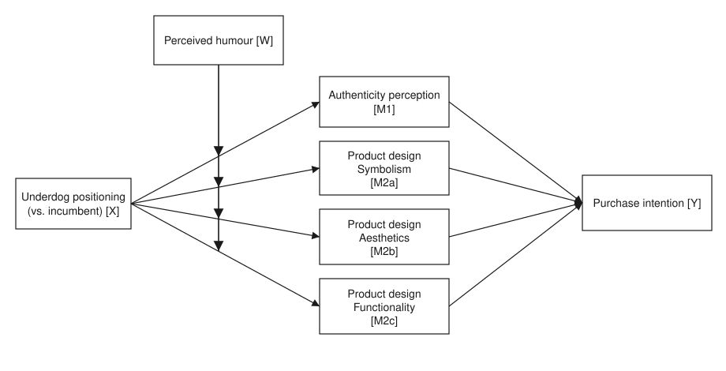
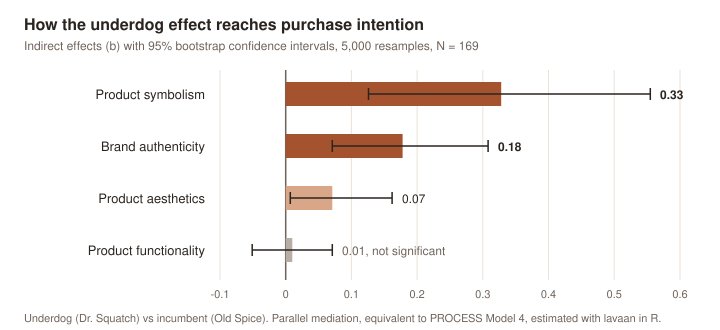

# No business ever differentiated itself by optimising

**An experiment on how challenger brands win in markets where the product can't get any better.**

Growth roles are usually hired to optimise: conversion rates, funnels, CAC, retention curves. That work matters, but it has a ceiling. In a mature category, every competitor can run the same playbook, and optimisation alone never makes a brand *different*. The part that does, meaning, identity and trust, rarely makes it into a growth job description.

My MSc dissertation tests that idea with an experiment. The short version: **when the product has hit its functional ceiling, people don't buy the better soap. They buy the soap that means something to them.**

> MSc Consumer Analytics & Marketing Strategy, University of Leeds, 2026. Dissertation: *The underdog effect as differentiator for new product development in mature markets.*

---

## The business problem

Bar soap is a textbook mature market: a handful of corporate incumbents, huge distribution, and a product that already does its job. Reformulating the chemistry doesn't make anyone more satisfied, so the usual new-product-development answer (better features, more R&D) stops working.

Yet a challenger, **Dr. Squatch**, broke into this market with a functionally simple product and grew fast enough to be acquired by Unilever. It didn't win on performance. It won on story: a small, passionate brand taking on the giants, with irreverent humour and strong identity cues.

**Question:** does an underdog positioning actually increase purchase intention against an incumbent, and if so, *through what?*

## The experiment

- **Design:** randomised, two-group, between-subjects experiment.
- **Conditions:** each participant saw one real brand.
  - **Underdog (Dr. Squatch):** a short description of its humble origins (Kickstarter, limited resources) and a 30-second ad.
  - **Incumbent (Old Spice):** a short description of its market leadership and a 32-second ad.
- **Sample:** 169 valid responses (78 underdog, 91 incumbent), adults recruited online.
- **Measures:** validated academic scales for purchase intention, brand authenticity, the three dimensions of product design (function, aesthetics, symbolism) and perceived humour. All scales reliable (Cronbach's α between 0.73 and 0.92).
- **Analysis:** t-tests, then parallel mediation and moderated mediation models with 5,000 bootstrap resamples, in R.

## Results

**1. The underdog story alone isn't enough.**
Purchase intention was higher for the underdog (2.97 vs 2.65 on a 1 to 5 scale), but the difference was only marginal (p = 0.07, d = 0.28). Simply *being* the small brand doesn't sell.

**2. It works through meaning, not performance.**
Once the mechanisms are modelled, the picture is clear. The total indirect effect is significant (b = 0.59, 95% CI [0.31, 0.86]):

| Path to purchase intention | Effect (b) | 95% CI | Result |
|---|---|---|---|
| Product **symbolism** (I identify with it, it's cool, it's different) | **0.33** | [0.13, 0.56] | Strongest driver, over half of the effect |
| Brand **authenticity** (honest, cares about consumers) | **0.18** | [0.07, 0.31] | Second driver |
| Product **aesthetics** | 0.07 | [0.01, 0.16] | Small but real |
| Product **functionality** | 0.01 | [-0.05, 0.07] | No effect |

Functionality, the dimension most product teams invest in, played **no role at all**.

**3. Consumers read "passion", not "disadvantage".**
Participants saw Dr. Squatch as clearly more *passionate and determined* than Old Spice (3.95 vs 3.54, p = 0.004). They did **not** see it as significantly more *disadvantaged* (p = 0.10). The underdog story lands through visible commitment to the craft, not through playing the victim.

**4. Humour gets attention, not meaning.**
Both brands use humour heavily, so I tested whether it amplifies the effect. It didn't: humour did not moderate any of the four paths. It helps an ad get watched; it doesn't change what the brand or product means.

## What this means for a growth team

1. **Optimisation has a ceiling; meaning doesn't.** In a mature category, the next point of conversion is less likely to come from another funnel tweak than from what the product says about the person buying it.
2. **Invest in symbolism.** Identity, coolness and "this is for people like me" carried more than half of the effect. Founder stories, community and product cues that signal identity are growth levers, not just brand fluff.
3. **Protect authenticity.** Honesty, transparency and visible care for the customer are a moat incumbents struggle to copy. They are also what gets lost when a challenger "sells out" after an acquisition.
4. **Show passion, not struggle.** Messaging should prove commitment to the craft rather than lean on how small or disadvantaged the brand is.
5. **Use humour for reach, not for positioning.** It's a distribution tool, not a substitute for meaning.

## Limitations

- **Sample.** 169 responses from a convenience sample. Statistical power to detect the direct effect was about 46%; around 400 responses would be needed to reach the usual 80%.
- **Real brands.** Using real brands and real ads gives realism, but the two conditions differ in more than positioning: different ads, products (bar soap vs body wash) and prior familiarity (60% of participants did not know Dr. Squatch).
- **Manipulation check.** Only the "passion" side of the underdog was perceived differently; the "disadvantage" side was not.
- **Single-item aesthetics.** Product aesthetics was measured with one item, so that result should be read with caution.

---

*Tomás Mora · [Portfolio](https://tmorac.github.io/growth/) · [LinkedIn](https://www.linkedin.com/in/tomas-mora-c)*
